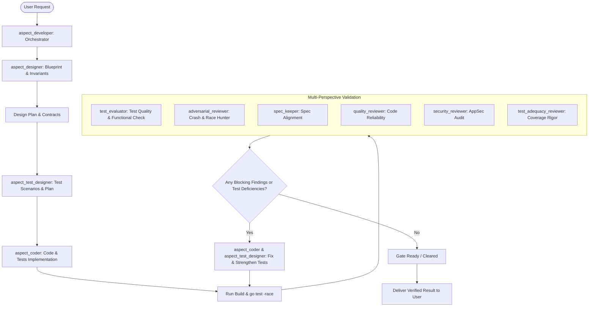

# Aspect Development Workflow

Use this workflow whenever implementing features, bugfixes, or refactors in Aspect.

## Execution Sequence



## Step 1: Design & Planning
Invoke `aspect_designer`:
- Analyze the formal spec (`_aspect/aspect.yaml`, briefs), design docs, and code dependencies.
- Define target files, data models, function signatures, pre/post conditions, and invariants.
- Outline test scenarios (happy path, error cases, invariant violation attempts).

## Step 2: Collaborative Code & Test Implementation
Invoke `aspect_test_designer` and `aspect_coder`:
- `aspect_test_designer`: formulate the comprehensive test plan, Given/When/Then scenarios, invariant tests, and boundary matrices.
- `aspect_coder`: write production code and tests matching the blueprint and test plan.
- Enforce Go standards and English documentation.
- Execute:
  ```bash
  gofmt -l . && go vet ./... && go test -race ./...
  ```

## Step 3: Multi-Agent Validation
Invoke the review subagents:
- `test_evaluator`: evaluates test design, verifies functional test presence, unit test coverage adequacy, test efficiency, and quality guarantees.
- `adversarial_reviewer`: hunts for crashes, concurrency races, off-by-one errors.
- `spec_keeper`: checks spec alignment and drift.
- `quality_reviewer`: checks error handling and resource cleanup.
- `security_reviewer`: audits for input validation and path safety.
- `test_adequacy_reviewer`: confirms non-flaky test coverage for all new paths.

## Step 4: Remediation Loop
If any finding has severity `critical`, `high`, or test coverage is inadequate:
- Pass findings to `aspect_coder` and `aspect_test_designer` to remediate and add automated tests.
- Re-run verification until all gates and test evaluations are cleared.

## Step 5: Deliver Result
Present the verified change, tests run, and validation verdicts to the user.
