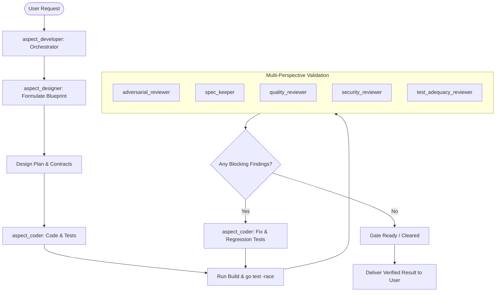

# Aspect Development Workflow

Use this workflow whenever implementing features, bugfixes, or refactors in Aspect.

## Execution Sequence



## Step 1: Design & Planning
Invoke `aspect_designer`:
- Analyze the formal spec (`_aspect/aspect.yaml`, briefs), design docs, and code dependencies.
- Define target files, data models, function signatures, pre/post conditions, and invariants.
- Outline test scenarios (happy path, error cases, invariant violation attempts).

## Step 2: Code Implementation
Invoke `aspect_coder`:
- Write the code and tests matching the blueprint.
- Enforce Go standards and English documentation.
- Execute:
  ```bash
  gofmt -l . && go vet ./... && go test -race ./...
  ```

## Step 3: Multi-Agent Validation
Invoke the review subagents:
- `adversarial_reviewer`: hunts for crashes, concurrency races, off-by-one errors.
- `spec_keeper`: checks spec alignment and drift.
- `quality_reviewer`: checks error handling and resource cleanup.
- `security_reviewer`: audits for input validation and path safety.
- `test_adequacy_reviewer`: confirms non-flaky test coverage for all new paths.

## Step 4: Remediation Loop
If any finding has severity `critical` or `high`:
- Pass findings to `aspect_coder` to remediate and add regression tests.
- Re-run verification until all blocking findings are resolved.

## Step 5: Deliver Result
Present the verified change, tests run, and validation verdicts to the user.
